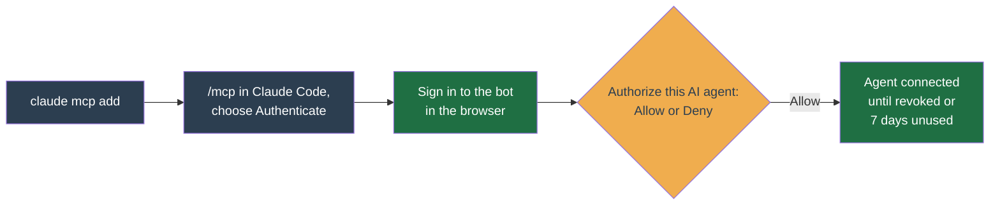

# AI agents (MCP)

You can connect an AI agent, such as Claude Code, to the bot over the Model Context Protocol (MCP), an open standard that lets an AI assistant call tools in another app. The agent can then answer questions about your accounts ("why is BTCUSDT not buying?") and act on them ("stop the test profile").

It is **off by default**. Turning it on puts a trading endpoint on the internet, so try it on a testnet account first.

## What an agent can do

The consent page lists every permission the agent asks for. **Allow** grants all of them and **Deny** grants none; you cannot pick some. Claude Code asks for all three:

| Permission, as the consent page names it | Allows |
| --- | --- |
| **Read everything** (`mcp:read`) | Accounts, profiles, positions, orders, balances, trade history, logs, settings and backtests. It can also preview or check a strategy config without saving it. |
| **Trade and change settings with real funds** (`mcp:trade`) | Place and cancel orders, including a market order on every symbol of one quote asset in a profile at once. Sell out of a symbol. Start, stop and create profiles, and switch their strategy. Add, remove, turn on and turn off symbols. Change strategy, risk and discovery settings, and a position's recorded entry price. Convert dust balances to BNB, take over orders placed outside the bot, and reset a symbol's grid state. Run backtests and the AI advisor, which spends your AI provider credits on any account. On a live account this spends real money. |
| **Stay connected for up to 7 days** (`offline_access`) | Renew its own access instead of asking you again every hour. |

So with Claude Code, **Allow** means the agent can trade. Keep that in mind:

- An agent reading market news or logs is reading text anyone could have written, and that text can try to steer it.
- Read access alone still shows the agent your balances and trade history. An agent with other tools, such as web access, could be tricked into sending that data elsewhere.

No agent can ever back up or restore the database, read or change Binance API keys or notifier secrets, add or delete accounts, delete a profile or trade history, change notifiers, or touch sign-in settings.

## Turn it on

Set two [environment variables](env-vars.md) and restart the app:

```bash
MCP_ENABLED=1
MCP_RESOURCE_URL=https://bot.example.com/api/mcp
```

- `MCP_RESOURCE_URL` must be the `https` address the agent actually reaches (`http` is accepted only for a loopback host such as `localhost`). Tokens are bound to this exact string, so if the agent reaches the bot at any other address, such as a public proxy in front of an internal one, every call fails with a 401.
- If `PUBLIC_BASE_URL` is set, both must share the same origin.
- The app refuses to start with both `MCP_ENABLED` and `LIVE_DEMO` on.

## Connect Claude Code



Add the server, using the same URL as `MCP_RESOURCE_URL`:

```bash
claude mcp add --transport http binance-bot https://bot.example.com/api/mcp
```

Then:

1. In Claude Code, run `/mcp`, pick `binance-bot`, and choose to authenticate. A browser opens.
2. Sign in to the bot as usual, with a password or single sign-on.
3. On **Authorize this AI agent**, check the web address shown under **Request from**. It is the only part the bot can verify; the name under it is the client's own claim. Approve only a request that a client you started yourself just opened, never one you reached from a link. Then choose **Allow**.

An agent in regular use stays connected until you revoke it; one unused for 7 days must be approved again. Other MCP clients can connect if they support OAuth with a Client ID Metadata Document; the bot does not let clients register themselves.

## While an agent is connected

- **Nothing forces a confirmation before a trade.** The bot marks every write tool as destructive, which is advisory. Whether Claude Code asks you first depends on your own permission settings: in bypass mode, in auto mode (a classifier decides, not a person), or with an allow rule, including one saved through a "don't ask again" choice, an agent can place and cancel live orders and change live config with nobody present. An explicit `ask` rule in Claude Code still forces a prompt in every mode, so add one for any tool you want to confirm. Another MCP client, or your own Agent SDK code, may run trade calls without asking.
- **You are normally told about each completed agent write, if a notifier is set up.** Each completed trade or settings change sends an **AI agent changed something** notification to the account's notifiers. This is best effort: if the bot cannot queue the message, the write still stands and only a server log records it. A call that ends in a server error sends nothing and writes no audit row, yet it may still have armed an order, so check open orders after one. With no notifier, nothing is sent and nothing warns you, so set one up first. You can mute it under **Operational alerts** on **Settings**, but you would lose your only visible record.
- **The audit log does not show who acted.** The database records the agent as the actor, with its address and user agent, but the audit log on a profile's **History** page does not display it yet.
- **A retry with the same key within 15 minutes is not placed twice.** Order tools need a unique key per order. For 15 minutes, a retry with the same key gets the first call's result if it succeeded. If the bot refused the first call, the key is freed and the retry runs again. If the first call is still running, the retry is told to wait; if it failed in a way that may have placed an order, the retry is told to check the orders first. Reusing a key for a different order is refused. A new key is a new order, and the agent chooses the key.
- **The same checks apply.** An agent's call runs the same code as the web app, including the [risk](../user-guide/profile/risk.md) breakers. An order for a symbol not on the profile is refused, but with the trade permission the agent can add symbols, widen discovery, create profiles and change those risk limits, so none of these limits it.
- **Calls are limited.** All agents together may make 120 calls a minute.

## Revoke access

On **Settings > Security**, under **AI agent access**, choose **Revoke all agent access**. It takes effect immediately, including for tokens an agent already holds. Changing or resetting your password and **Sign out everywhere** do the same.

Revoking stops new calls only. It does not cancel orders the agent placed or undo settings it changed. If you suspect misuse, revoke first so the agent cannot lift the stop, then use the [kill switch](kill-switch.md), confirm it is still on, and review open orders and each profile's risk and discovery settings.

## How it works

For the authorization flow, the full allow and deny lists, and how a tool call reaches the same code as the web app, see [MCP control plane](../architecture/mcp.md).
